# Installing SMS Toolbox outside the Play Store

The Google Play version of SMS Toolbox includes **Backup** only. The full version,
with **Redirect** (forward SMS by rule) and **Schedule** (send SMS later), is published
as an APK on the [GitHub Releases page](https://github.com/neteinstein/SMS-Redirect/releases/latest).
This guide explains how to install it.

You do **not** need Developer mode for a normal install. That is only needed for the
[ADB method](#alternative-install-with-adb-developer-mode) at the end.

> Screenshots are from a Pixel running Android 17. On other phones (Samsung, Xiaomi, …)
> the wording and menu positions differ slightly, but the steps are the same.

## Before you start

- **Android 13 or newer** is required.
- **Already have the Play Store version?** Uninstall it first. The two are signed
  differently, so Android will refuse to install one over the other. Your rules,
  schedules and settings are deleted with it, so export them first: **Settings → Export**,
  then **Import** the file after installing.
- Your Gmail backups are not affected; they live in your Gmail account.

## 1. Download the APK

On your phone, open the
[latest release](https://github.com/neteinstein/SMS-Redirect/releases/latest), expand
**Assets** and tap `SMS-Toolbox_vX.Y.Z.apk`. Your browser may warn that this kind of
file can be harmful. Choose **Download anyway**.

## 2. Allow your browser or file manager to install apps

The first time you open an APK from a given app (Chrome, Files, …), Android asks you to
allow it. Tap **Settings** in that prompt and turn on **Allow from this source**, then go
back.

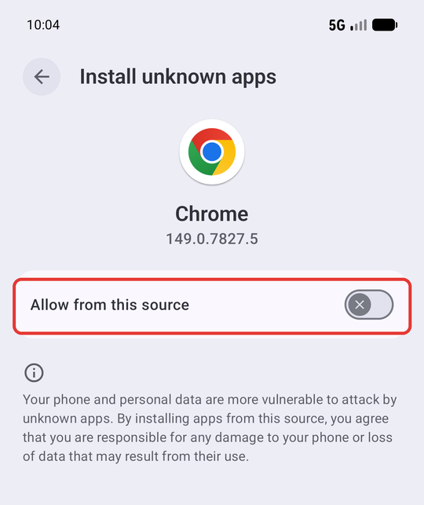

You can turn this off again after installing. It only controls whether that app may
install other apps.

## 3. Install

Open the downloaded file, from the browser's download notification or from
**Files → Downloads**.

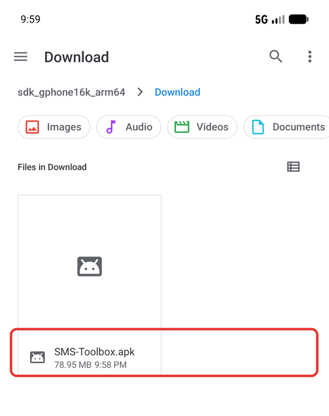

Android warns about apps from unknown sources. Tap **Continue**, then **Install**.

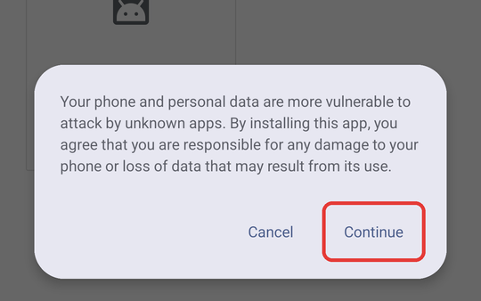 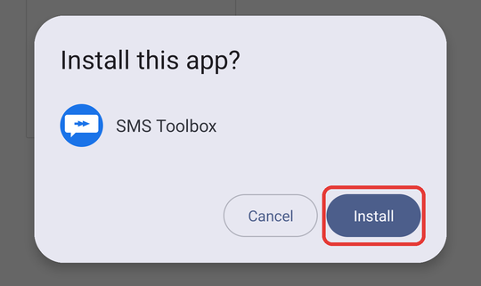

**Google Play Protect** hasn't seen this build, so it will offer to scan it. You can
either tap **Scan app**, which uploads the APK to Google, or tap **More details** and then
**Install without scanning**. The source code is public, so you can check exactly what you
are installing.

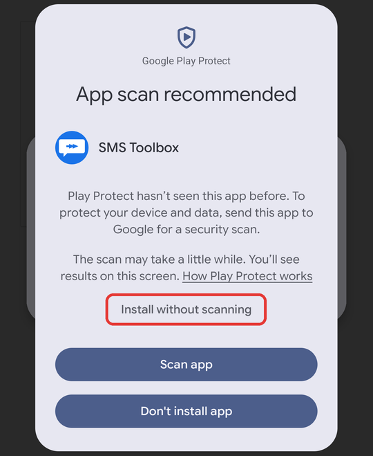

When it says **App installed**, tap **Open**.


## 4. Allow restricted settings (required for SMS)

Android blocks SMS permissions for apps that were not installed from an app store. This
takes one extra step, and it **only becomes available after Android has blocked the
permission once**:

1. In SMS Toolbox, start something that needs SMS access (turn on Backup, or add a rule
   or scheduled message) and tap **Proceed**. Android answers with
   **"App was denied access to SMS"**. Tap **Close**. This is expected.

   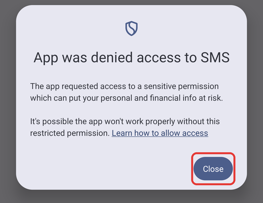

2. SMS Toolbox then explains what to do. Tap **OK** to jump to its **App info** page
   (or open **Settings → Apps → SMS Toolbox** yourself), then tap the **⋮** menu at the
   top right.

   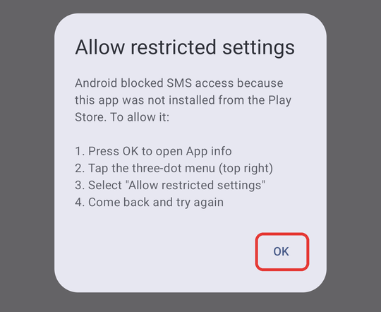

   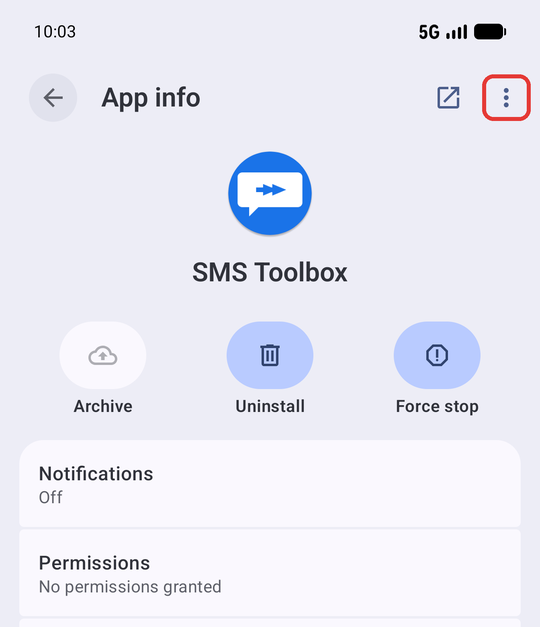

3. Tap **Allow restricted settings** and confirm with your PIN or fingerprint if asked.

   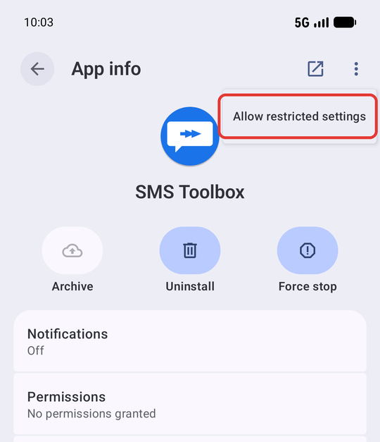

4. Go back to SMS Toolbox and repeat what you did in step 1. This time Android shows
   the normal permission prompt. Tap **Allow**.

   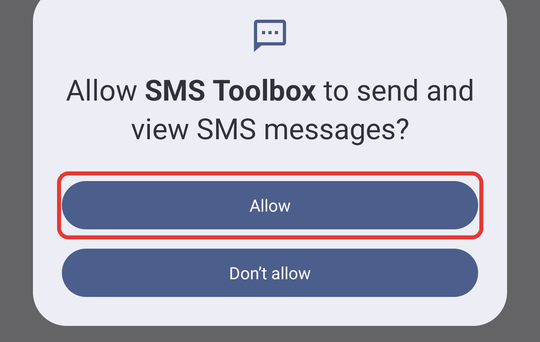

If the **⋮** menu has no **Allow restricted settings** entry, you have not hit the block
yet. Do step 1 first.

## 5. Finish setting up

- **Battery:** when asked, let SMS Toolbox run in the background. Otherwise Android may
  delay forwarding, scheduled sends and backups.
- **Notifications** and **Contacts** are requested the first time you use a feature that
  needs them.
- **Backup:** add your Gmail address and an
  [app password](https://myaccount.google.com/apppasswords) in **Settings**.

## Updating

Sideloaded apps do not update automatically. To update, download the newer APK from
[Releases](https://github.com/neteinstein/SMS-Redirect/releases) and install it over the
existing app (steps 1–3). Your data and permissions are kept.

## Alternative: install with ADB (Developer mode)

This method is for developers or if you prefer installing from a computer.

1. **Enable Developer mode:** **Settings → About phone**, tap **Build number** seven
   times until you see *"You are now a developer!"*. On some phones Build number is under
   **Software information**.

   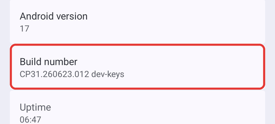

2. **Enable USB debugging:** **Settings → System → Developer options → USB debugging**.

   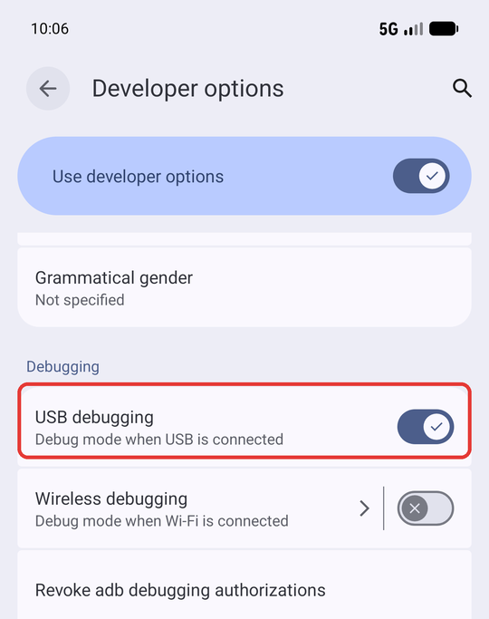

3. Connect the phone by USB, accept the **Allow USB debugging?** prompt on the phone,
   and install with
   [Android platform-tools](https://developer.android.com/tools/releases/platform-tools):

   ```bash
   adb install -r SMS-Toolbox_vX.Y.Z.apk
   ```

4. Open the app and grant permissions when asked. Apps installed with `adb install` are
   **not** restricted, so [step 4](#4-allow-restricted-settings-required-for-sms) is not
   needed: Android shows the normal SMS prompt straight away.

You can turn Developer options off again afterwards; the app keeps working.

## Troubleshooting

| Problem | Fix |
|---|---|
| "App not installed" / "package conflicts with an existing package" | The Play Store version (or an older build with a different signature) is installed. Uninstall it first. See [Before you start](#before-you-start). |
| "App was denied access to SMS" keeps appearing | Do [step 4](#4-allow-restricted-settings-required-for-sms). |
| No "Allow restricted settings" in the ⋮ menu | Trigger the SMS permission request in the app once first, then check again. |
| Permission toggle greyed out in Settings → Apps → Permissions | Same cause: allow restricted settings first. |
| Forwarding or scheduled messages arrive late | Allow background running / disable battery optimization for SMS Toolbox. |
