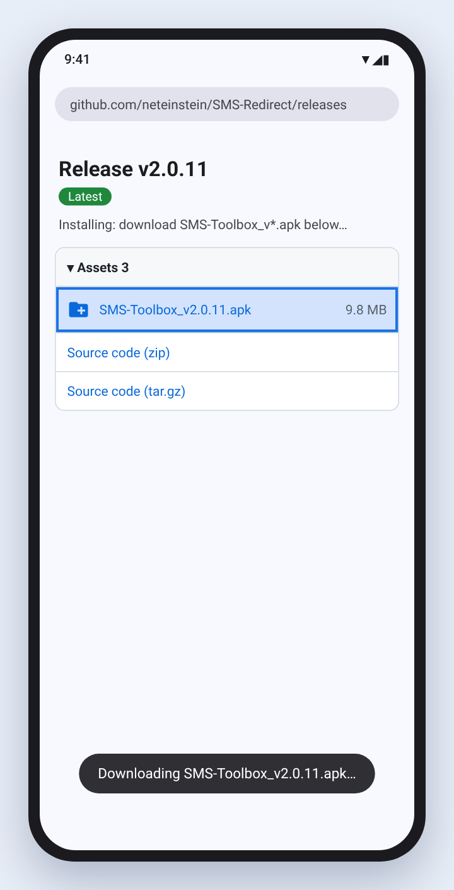
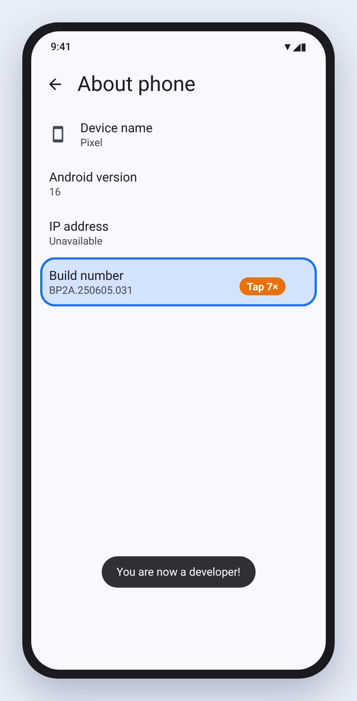
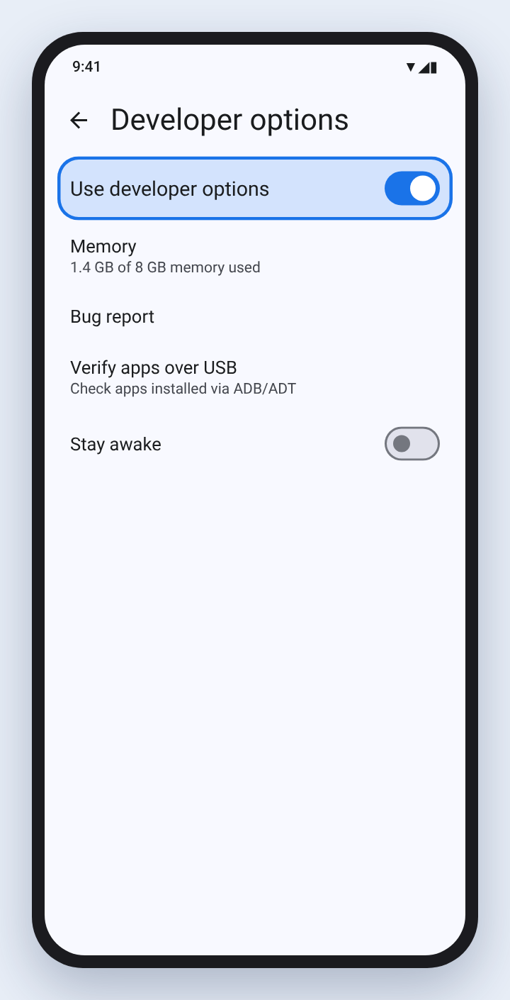
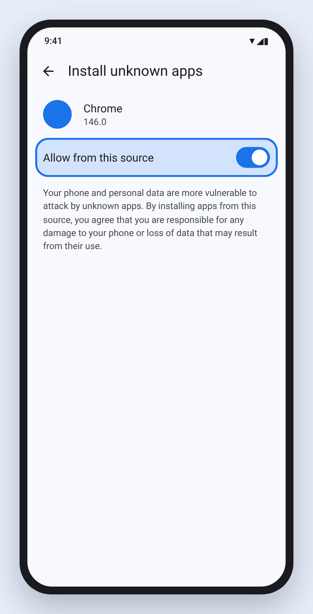
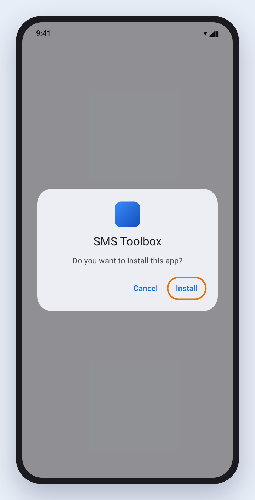
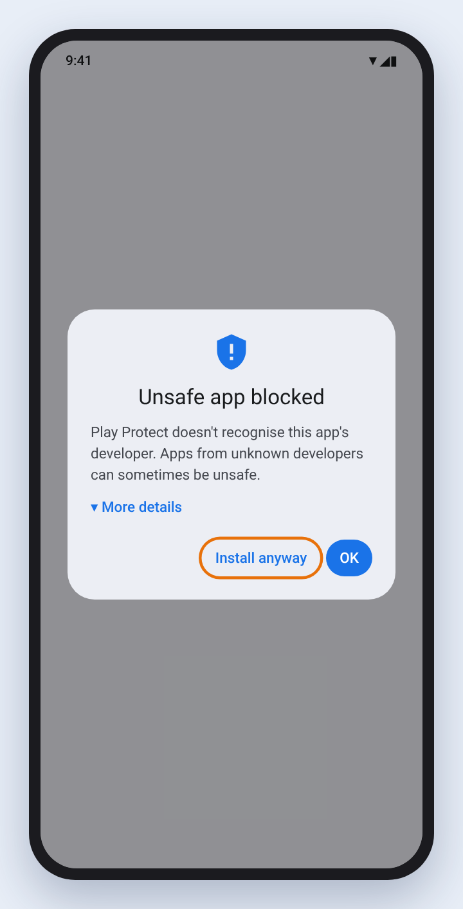
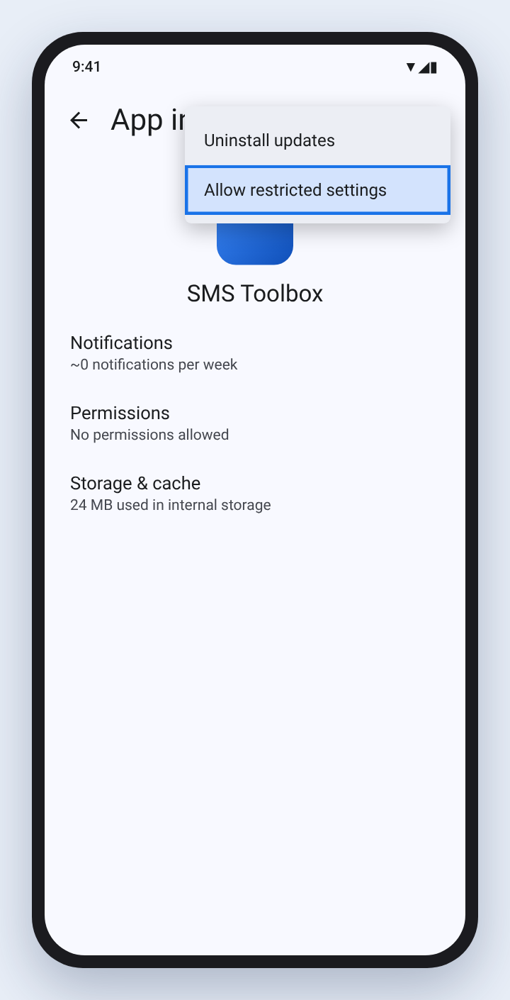
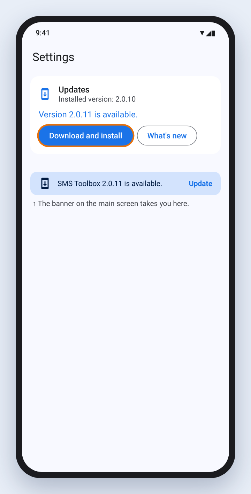

# SMS Toolbox

Android app built with Kotlin + Gradle Kotlin DSL implementing MVVM clean architecture (domain use cases, repository, and Room database).

Three features, as bottom-navigation tabs: **Backup** SMS to your own Gmail account (and **restore** them to a new phone), **Redirect** incoming SMS by rule, and **Schedule** messages to send later.

*Silent preview. The full 24-second launch video, with music, is [`store-listing/video/sms-toolbox-launch.mp4`](store-listing/video/sms-toolbox-launch.mp4) (download it to watch).*

## Install the APK (outside Google Play)

The GitHub APK has every feature (Backup & Restore, Redirect, Schedule). Installing it takes about five minutes the first time; after that the app updates itself from GitHub. If you only need Backup & Restore, the [Google Play version](https://play.google.com/store/apps/details?id=com.neteinstein.smsredirect) is simpler.

> The pictures are illustrations of stock Android 14–16. Wording and menu locations differ a little between phone makers (Samsung, Xiaomi, OnePlus…), but the steps are the same.

### 1. Download the APK

On your phone, open the [latest release](https://github.com/neteinstein/SMS-Redirect/releases/latest) and, under **Assets**, tap **`SMS-Toolbox_v….apk`**. Only download it from this page. If your browser warns that *"this type of file can harm your device"*, tap **Download anyway**.

### 2. Turn on Developer options

1. Open **Settings → About phone**.
2. Tap **Build number** seven times. Enter your PIN if asked.
3. You see **"You are now a developer!"**

Then open **Settings → System → Developer options** and make sure **Use developer options** is on. Nothing else in there needs changing.

> Some phones only allow installing apps from outside Google Play with Developer options on. On many phones this step is not needed; it does no harm, and you can turn Developer options off again once the app is installed.

### 3. Allow your browser to install apps

Open the downloaded file (from the download notification, or **Files → Downloads**). The first time, Android says your phone *"isn't allowed to install unknown apps from this source"*. Tap **Settings**, turn on **Allow from this source**, then go back.

### 4. Install, and accept the warnings

1. Android asks **"Do you want to install this app?"**: tap **Install**.

   

2. **Google Play Protect** may stop the install because the app did not come from Play. Tap **More details**, then **Install anyway**. If it offers to scan the app, you can let it: the APK is built from the public source in this repository by [`release.yml`](.github/workflows/release.yml).

   

### 5. Allow restricted settings (Android 13 and later)

Android blocks SMS permissions for apps installed outside an app store until you allow them once. The app shows a reminder the first time you open it.

1. Open **Settings → Apps → SMS Toolbox**.
2. Tap the **⋮** menu in the top-right corner, then **Allow restricted settings**, and confirm with your PIN or fingerprint.

Now open SMS Toolbox. It asks for each permission only when a feature needs it.

### 6. Updates

Once a day, when you open it, the app checks this repository for a new release. When there is one, a banner appears at the top of the main screen: tap **Update**, then **Download and install** in **Settings → Updates**. The first time, Android asks you to allow SMS Toolbox to install apps (like step 3). Your settings and backups are kept.

Moving between the Play and GitHub versions, and what the update check sends, are covered in the [full install guide](docs/install-apk.md).

## Development

Building, testing, the feature list, on-device and emulator testing, Firebase setup, and the tech stack are in [Development.md](Development.md). The system design is in [Architecture.md](Architecture.md) and the privacy policy in [PrivacyPolicy.md](PrivacyPolicy.md).
