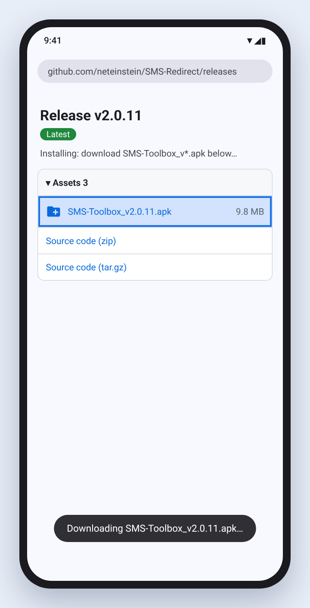
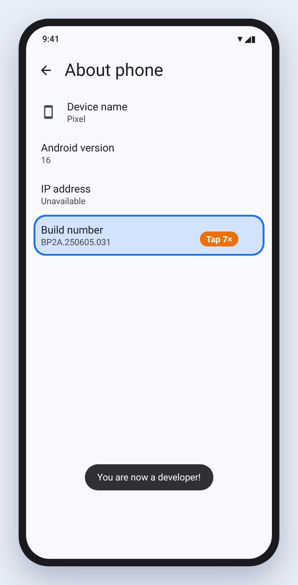
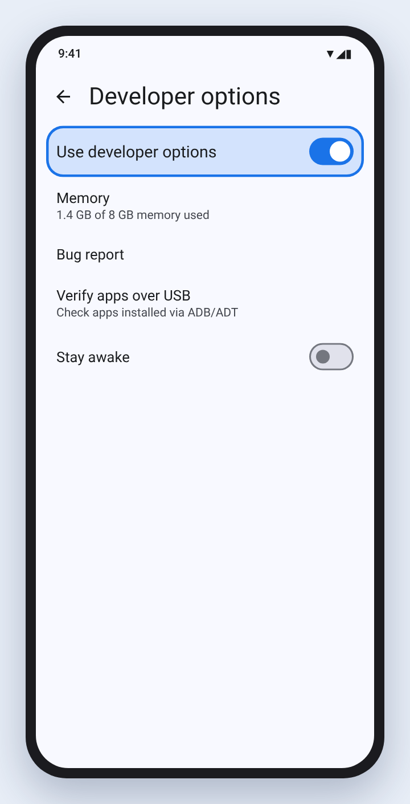
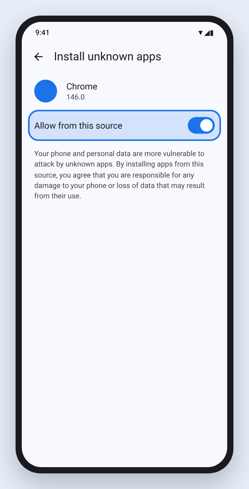
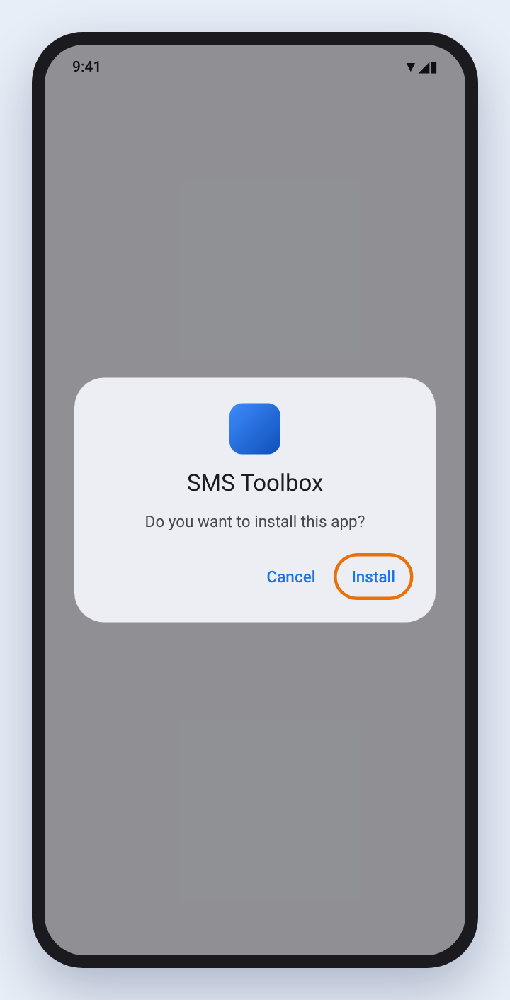
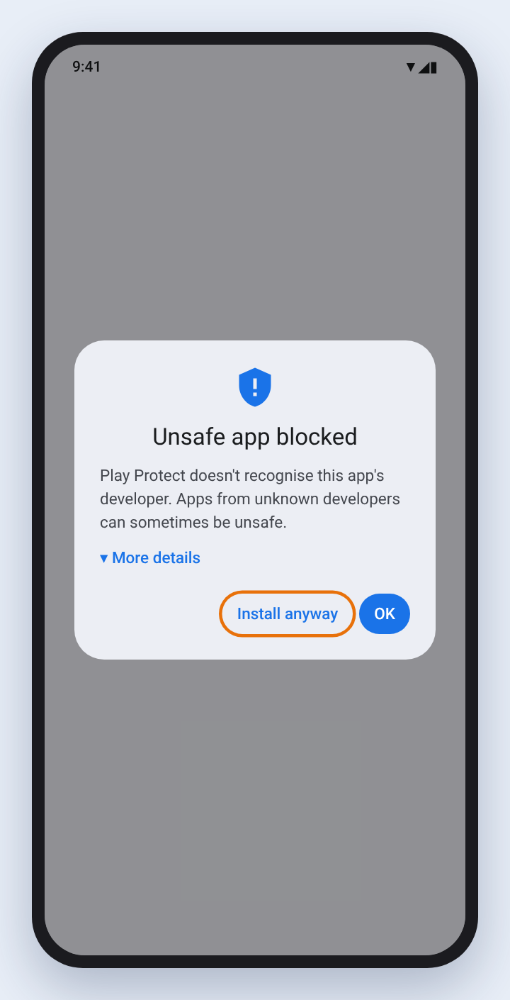
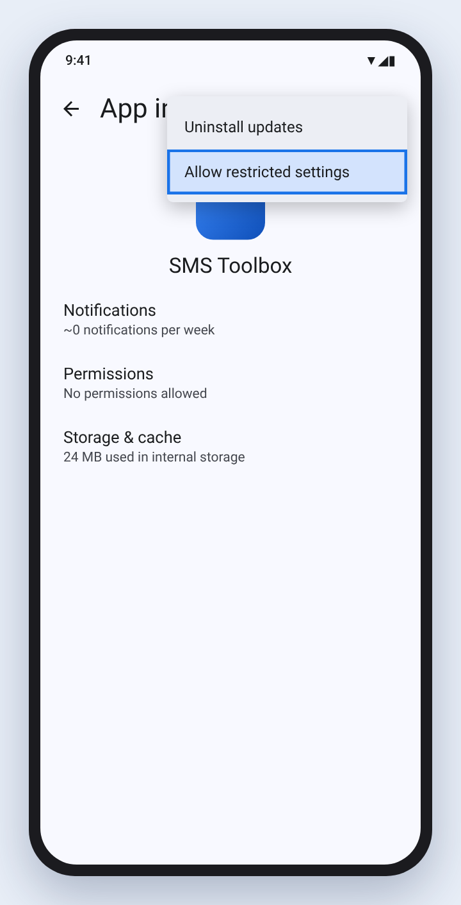
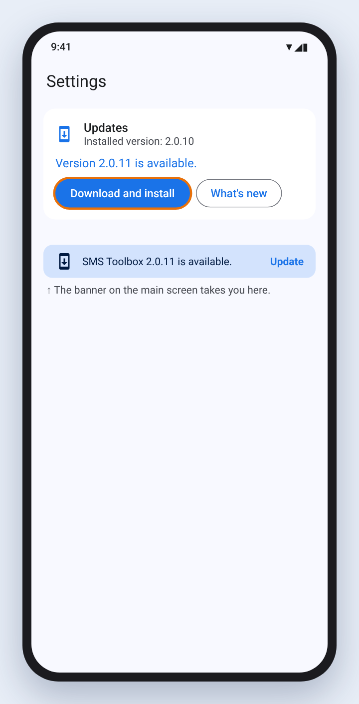

# Install SMS Toolbox from GitHub (APK)

SMS Toolbox comes in two versions. They are the **same app**: same package name
(`com.neteinstein.smsredirect`), signed with the **same key**. Android treats them
as one app, so you can move from one to the other without uninstalling or losing
your settings, and either one can update the other.

| | Google Play | GitHub APK |
|---|---|---|
| Back up SMS to your Gmail | ✅ | ✅ |
| Restore SMS from Gmail | ✅ | ✅ |
| Redirect (forwarding rules) | — | ✅ |
| Schedule messages | — | ✅ |
| Updates | Automatic, by Play | In-app: a banner tells you, Settings → Updates installs it |

If you only need backup and restore, use the Play version. If you want Redirect or
Schedule, install the APK as shown below. It takes about five minutes the first
time; after that the app updates itself from GitHub.

> The pictures below are illustrations of stock Android 14–16. The wording and menu
> locations differ a little between phone makers (Samsung, Xiaomi, OnePlus…), but
> the steps are the same.

---

## 1. Download the APK

On your phone, open the
[latest release](https://github.com/neteinstein/SMS-Redirect/releases/latest) and,
under **Assets**, tap **`SMS-Toolbox_v….apk`**. Only download it from this page.
Your browser may warn that *"this type of file can harm your device"*: tap
**Download anyway**.



## 2. Turn on Developer options

1. Open **Settings → About phone**.
2. Tap **Build number** seven times. Enter your PIN if asked.
3. You see **"You are now a developer!"**



Then open **Settings → System → Developer options** and make sure **Use developer
options** is on. You do not need to change anything else in there.



> **Why?** Newer Android versions, and some phone makers, only let you install apps
> from outside Google Play when Developer options are on. On many phones this step
> is not needed; it does no harm, and you can turn Developer options off again
> once SMS Toolbox is installed.

## 3. Allow your browser to install apps

Open the downloaded file (from the download notification, or **Files → Downloads**).
The first time, Android says that your phone *"isn't allowed to install unknown apps
from this source"*. Tap **Settings**, turn on **Allow from this source**, then go back.



## 4. Install, and accept the warnings

1. Android asks **"Do you want to install this app?"**: tap **Install**.

   

2. **Google Play Protect** may stop the install, because the app did not come from
   Play. Tap **More details**, then **Install anyway**. If it offers to *scan* the
   app, you can let it: the APK is built from the public source code in this
   repository by [this workflow](https://github.com/neteinstein/SMS-Redirect/blob/main/.github/workflows/release.yml).

   

## 5. Allow restricted settings (Android 13 and later)

Android blocks SMS permissions for apps installed outside an app store until you
allow them once. SMS Toolbox shows a reminder the first time you open it.

1. Open **Settings → Apps → SMS Toolbox**.
2. Tap the **⋮** menu in the top-right corner, then **Allow restricted settings**,
   and confirm with your PIN or fingerprint.



Now open SMS Toolbox. It asks for each permission only when a feature needs it.

## 6. Updates

Once a day, when you open it, SMS Toolbox checks this repository for a new release.
When there is one, a banner appears at the top of the main screen. Tap **Update**,
then **Download and install** in **Settings → Updates**. The first time, Android asks
you to allow SMS Toolbox to install apps (like step 3); after that, confirm the
install and you are done. Your settings and backups are kept.



You can also tap **Check for updates** in Settings → Updates at any time.

---

### Moving between the Play and GitHub versions

Because both are signed with the same key under the same package name, installing
one over the other is an ordinary update: nothing is lost. The only rule is
Android's: you cannot install an **older** version over a newer one. Both channels
get the same version number for the same release, so pick the APK that matches or
is newer than what you have.

If you go from the GitHub APK to the Play version, your Redirect rules and
schedules stay saved on the phone but do nothing, because the Play version does not
include those features. Install the GitHub APK again and they come back.

### Privacy

The update check is a single anonymous request to `api.github.com` (GitHub's public
API) at most once a day. It sends no information about you or your messages. See the
[privacy policy](https://github.com/neteinstein/SMS-Redirect/blob/main/PrivacyPolicy.md).

### Regenerating the illustrations

The pictures are drawn in HTML in [`scripts/install-guide/screens.html`](scripts/install-guide/screens.html):

```bash
NODE_PATH=$(npm root -g) node docs/scripts/install-guide/render.js
```
